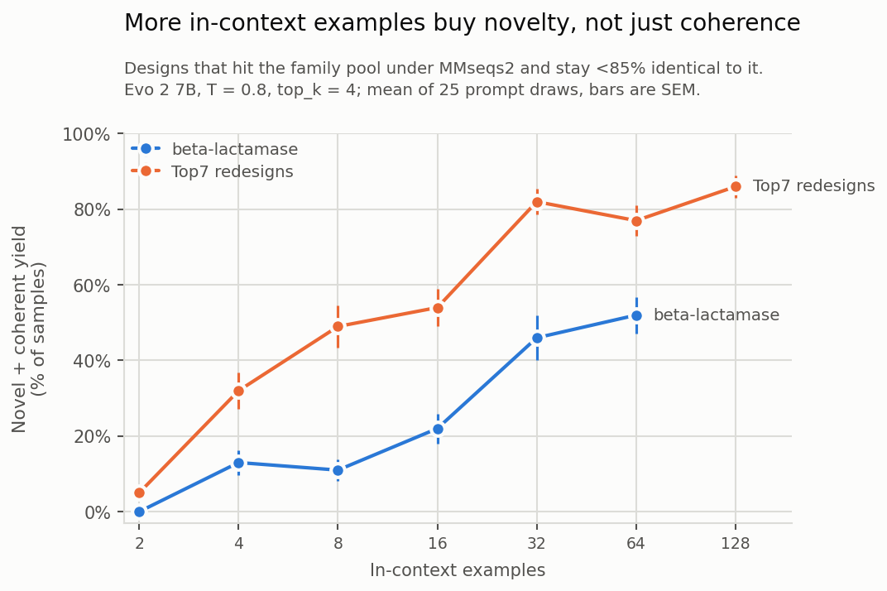

# Small-protein design by in-context learning

[**`small_protein_ICL.ipynb`**](small_protein_ICL.ipynb) &nbsp;·&nbsp;

Prompt Evo 2 with `n` members of a protein family, separated by a fixed
nucleotide spacer, and let it continue. The continuation is a new coding sequence — no
fine-tuning, no structure model, no optimizer. The notebook measures how many of those
sequences are both **coherent** (a real family member under MMseqs2) and **novel**
(< 85% identical to anything in the pool), as a function of `n`.

The figure above is the full-scale reference run (25 prompt draws × 4 samples per cell,
one H100). The notebook defaults to 10 draws so it fits a Colab session; its analysis
cells reproduce every value in that run exactly.

## Requirements

One GPU with ≥ 24 GB (Colab A100 or L4) and ~15 GB of disk for the `evo2_7b` checkpoint.
The notebook installs vLLM 0.26.0 (CUDA 12.9 wheel), `evo2-flash`, biopython and a static
MMseqs2 build itself.
